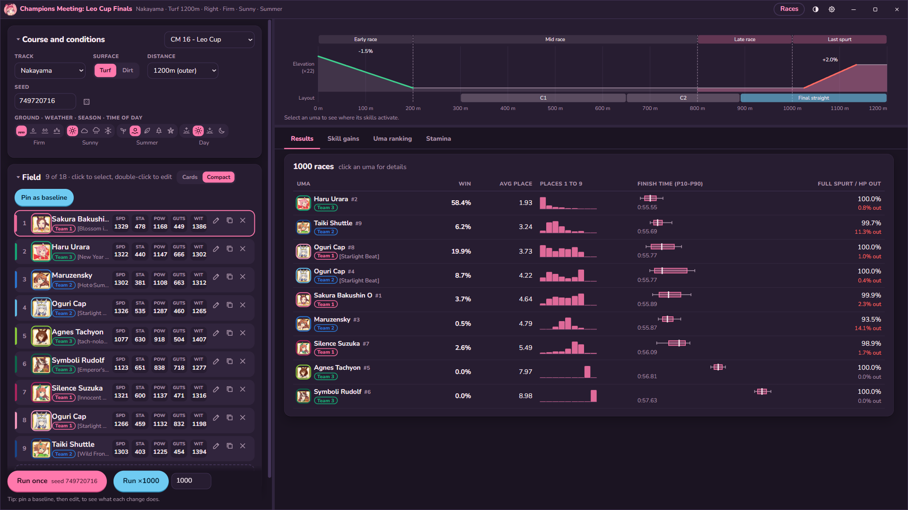
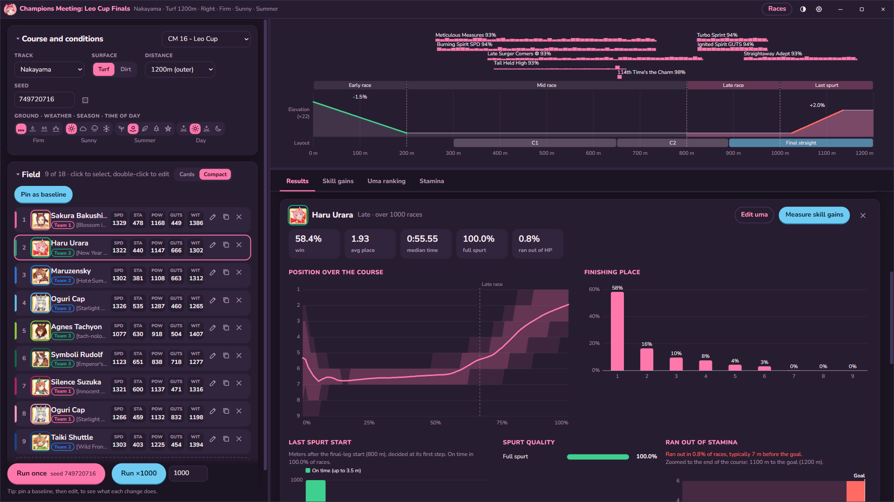
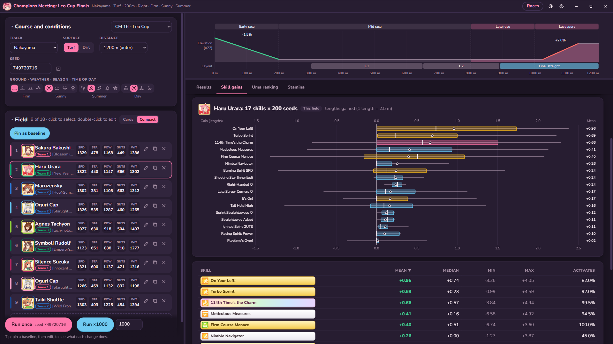
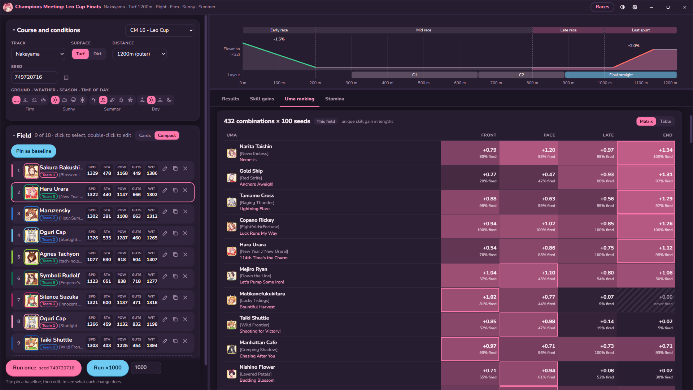
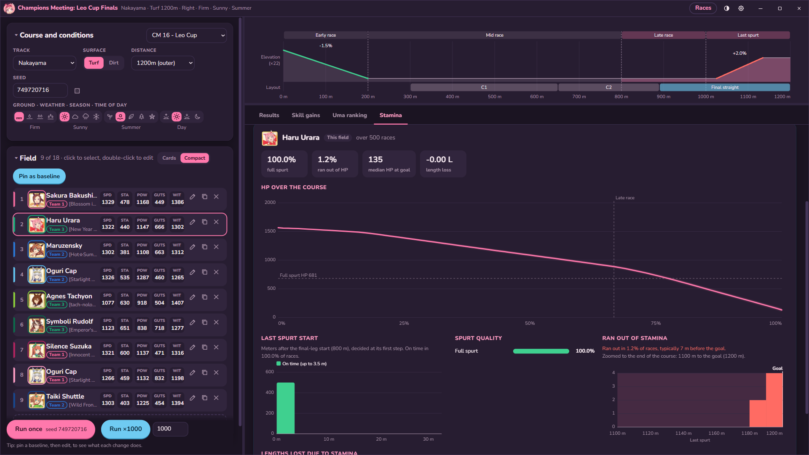

# Ulala sim!

A lil' vibe-coded app to integrate with my race simulator and provide an umalator-like experience.

That being said, if all you need is skill length gain/efficiency on a track, https://alpha123.github.io/uma-tools/umalator-global/ is likely going to be a lot more useful to you than something like this. 

This tool gives you complete control over lobby simulation, and implements all simulation mechanics including lane movement, blocking, overtaking, etcetera. These are lobby-reliant interactions between umas, so skills that depend on these things, will give varying results depending on the lobby you simulate with.

## Preview

### Results

### Uma details

### Skill gains

-L is due to knock-on effects of skills activating v not activating. On this track, this is usually due to that skill knocking Urara out of position for On Your Left! On one hand, it makes it more difficult to see raw length gains just from a singular skill, but on the other hand it does accurately portray the effect of this skill within that particular race/within this particular lobby setup.

A sample count higher than 200 races, along with some sort of option to vary the lobby per-race, would likely(?) increase the accuracy of these results - but it is interesting data nonetheless.

### Uma ranking

### Stamina

# Race simulator
(copied from https://github.com/kachi-dev/uma-race-simulator)

An umamusume simulator that is verifiably accurate to in-game races, allowing you to load race replays and tinker with uma skills/stats to see how races would've played out if you'd prepared a little bit more - or maybe if you feel like you just got unlucky you want to run 1000x simulations with the same lobby to see if you should've won after all...

Or maybe you just want a stamina calculator that is finally 100% accurate with no caveats or estimations~

See https://github.com/kachi-dev/ulala-sim (woah you're already here!) for a simulator that integrates uma-race-simulator

This project took a few days of work between myself and my top engineer (mr Opus 5.5) and his team of hallucinating sub-agents, and to be honest, that's the only reason this even exists - I don't have the time or arguably the skill to do this sort of thing myself but well I think this is interesting enough to share nonetheless~

Admittedly, this is probably just one of many upcoming race simulators, as AI has made reverse engineering trivial even for those with no decompilation/dissassembly experience. I imagine VMProtect/Themida stonks are rising at the moment, but I wouldn't be surprised if AI was even able to dump and reverse engineer virtualized code too...

# Art credits

- Chibi Urara (`chibi.webp`, app icon): [mochimochi kinako.](https://www.pixiv.net/artworks/88779143)
- Great! Urara (`great.webp`): [goom (goomyparty)](https://www.pixiv.net/artworks/134781489)
- Cheering Urara (`cheer.webp`) and game icons: official Umamusume art, © Cygames

